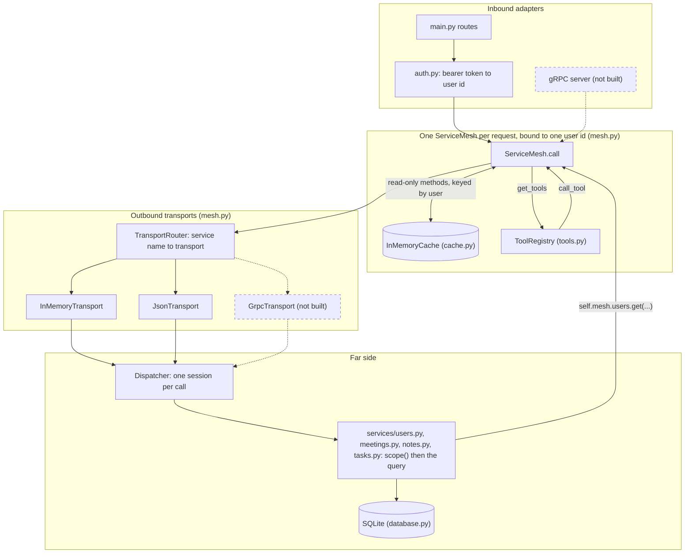

# Meeting Notes API

A FastAPI service for meetings, their attendees, notes, and tasks, on SQLite through SQLAlchemy. Every request
carries a bearer token and is served through an in-process service mesh: one service per resource, every call
routed through the mesh, read results cached per user, and every query scoped to what the caller may see.

## The brief and what was built

The brief asked for seven things. Each row says what was built for it.

| The brief asked for                         | What was built                                                     |
|---------------------------------------------|--------------------------------------------------------------------|
| Authentication, as simple as possible       | bcrypt password hash; a random bearer token stored as its SHA-256; |
|                                             | logging in again rotates it; no expiry; three public routes        |
| One service per resource on a base class    | `BaseService` with one abstract `scope()` hook; `UserService`,     |
|                                             | `MeetingService`, `NoteService`, `TaskService`                     |
| Services in a mesh, calls routed through it | An in-process `ServiceMesh` built per request; `mesh.meetings.get` |
|                                             | becomes an envelope through a router, a transport, and one         |
|                                             | dispatcher; services never import each other                       |
| User specific, supports caching             | The mesh is bound to one user id; every cache key starts with the  |
|                                             | user; only read-only methods are cached; a write clears whole      |
|                                             | services                                                           |
| Composable: in memory now, remote later     | `Transport` is a protocol; `InMemoryTransport` and `JsonTransport` |
|                                             | exist; one transport per service from the environment; gRPC would  |
|                                             | be one more class                                                  |
| A decorator behind `get_tools()`            | `@tool` on each service method; MCP tool definitions generated     |
|                                             | from type hints; `GET /tools`; `mesh.call_tool()` returns an MCP   |
|                                             | result                                                             |
| Only the caller's own resources reachable   | A meeting is visible to its attendees; notes and tasks inherit     |
|                                             | that; update and delete of a meeting are creator only; hidden and  |
|                                             | missing are both 404                                               |

## Architecture

One picture; every box is a class or module in this repository.



- A request enters at a route in `main.py`. `auth.py` turns the bearer token into a user id by reading the users
  table directly, the one database access outside the mesh, because a mesh cannot exist without a user.
- `ServiceMesh.call` checks the cache for read-only methods, keyed by user, before anything is routed. On a miss
  the call becomes a `CallEnvelope`, `TransportRouter` picks the transport for that service, and `Dispatcher`
  opens one session, builds the service, and runs the method. Every query inside passes through `scope()`.
- A service that needs a sibling writes `self.mesh.users.get(user_id=...)` and re-enters at `ServiceMesh.call`
  with the same user, cache, and router. Services never import each other; `tests/test_imports.py` enforces it.
- `get_tools()` reads the `ToolRegistry` built once at startup. `call_tool()` validates the arguments and enters
  `ServiceMesh.call` like any other caller.
- Dashed boxes are where a gRPC server and a `GrpcTransport` would sit. Neither is built.

## Key decisions

Six decisions carry the design. Each names the alternative rejected and the reason.

- "Service mesh" means an in-process mesh, not sidecars or a control plane: services are classes in one process,
  reached through a per-request mesh over a registry, a cache, a transport, and a dispatcher.
- One mesh per request, bound to one user, rather than a process-wide mesh taking the user on every call: the
  user is ambient, so no call site can forget it or pass the wrong one.
- One call path for endpoints and siblings, with no fast path for sibling calls: a sibling read is cached and a
  sibling write invalidates exactly as an endpoint's would.
- Hidden and missing both answer 404, never 403, because authorization lives in the queries: a row the caller
  may not see is absent, and the API never confirms a right the caller lacks.
- Only read-only methods are cached, and a write clears whole services rather than single keys: the safe default
  is a lost hit, never stale data after a write.
- Transport is a protocol with one dispatcher behind every transport: a remote transport is a new class, and
  session lifetime and error packaging live in one place.

## Composability

The mesh has five parts: a registry of service classes, a per-request `ServiceMesh` bound to one user id, a
cache, one `Dispatcher`, and a `Transport` between the mesh and the dispatcher. A caller writes
`mesh.meetings.get(meeting_id=1)`. The mesh checks the cache, builds a `CallEnvelope`, and `TransportRouter`
picks the transport for the envelope's service. The transport carries the envelope to the dispatcher, which
opens a session, builds the service, invokes the method, and returns a `Reply`. Two roles meet at the
dispatcher: inbound adapters above the mesh turn a request from outside into a call, and outbound transports
below the mesh carry a call to the dispatcher. `TRANSPORT_FACTORIES` in `mesh.py` is the one line that lists
the transports that exist.

`MESH_TRANSPORT` sets the transport for every service and `MESH_TRANSPORT_<SERVICE>` overrides one, so making
one service remote is one line of environment. A name outside `memory` and `json`, or an override that names
no registered service, fails at startup; nothing falls back silently.

```
MESH_TRANSPORT=memory|json              default for every service; unset means memory
MESH_TRANSPORT_MEETINGS=memory|json     override for meetings only
MESH_TRANSPORT_NOTES=memory|json        override for notes only
MESH_TRANSPORT_TASKS=memory|json        override for tasks only
MESH_TRANSPORT_USERS=memory|json        override for users only
```

Only Pydantic schemas and primitives cross the mesh, never ORM rows or sessions, and the user id is the only
identity that crosses. `JsonTransport` renders each envelope and reply as a JSON string and parses it back,
with unset fields excluded so a partial update keeps its meaning. Both sides rehydrate against the method's
type hints: the dispatcher before a session opens, the mesh before the cache stores the result. Neither a
service nor a caller ever sees a dict, whichever transport carried the call. An envelope for a partial update:

```json
{
  "user_id": 7,
  "service": "meetings",
  "method": "update",
  "arguments": {"meeting_id": 1, "data": {"title": "Kickoff"}}
}
```

A closed set of `MeshError` classes crosses as a payload of type name and message, and the caller's side raises
the same class again. `main.py` maps each to a status; the gRPC column is the status a remote client outside
this codebase would see, since inside it a gRPC transport would carry the error as a reply message.

| Error            | HTTP | gRPC status               | Note                                             |
|------------------|------|---------------------------|--------------------------------------------------|
| `NotFound`       | 404  | NOT_FOUND (5)             | Hidden and missing are the same answer           |
| `Conflict`       | 409  | ALREADY_EXISTS (6)        | Duplicate email on registration                  |
| `Invalid`        | 422  | INVALID_ARGUMENT (3)      |                                                  |
| `NoUser`         | 401  | UNAUTHENTICATED (16)      | Raised before any transport is reached           |
| `UnknownService` | 500  | UNIMPLEMENTED (12)        | A bug in the caller, not a client error          |
| `UnknownTool`    | 500  | never crosses a transport | Raised on the caller's side by the tool registry |
| anything else    | 500  | INTERNAL (13)             | Propagates unwrapped; never a reply              |

One `.proto` file with `CallEnvelope` and `Reply` as messages, their `arguments` and `result` fields as
`google.protobuf.Struct` or JSON-encoded strings since the wire shape is already JSON, and one service with one
unary `Send` rpc. `GrpcTransport(channel)` in `mesh.py` as a third `TRANSPORT_FACTORIES` entry, whose `send`
serialises the envelope, calls the stub, and parses the reply, carrying a `MeshError` as a reply message so the
caller's side raises the same class it raises today. A server shell, one module, that opens a listener and whose
`Send` handler parses the message, calls `dispatcher.dispatch`, and serialises the reply. Proto3 optional fields
would carry the unset-field distinction that `exclude_unset` carries in JSON. The one dependency, `grpcio`, and
the generated stubs are the reason it is not built here.

Adding it would not change any service, `ServiceMesh`, the cache, the dispatcher, the tool registry, or the
HTTP routes. Every test that uses the `runtime` fixture would stay as it is; the fixture would gain a third
parameter, and each of those tests would run once more over gRPC.

## Running it

Python 3.12 is required; the pinned pydantic does not build on 3.13 or later. Then:

```bash
python3.12 -m venv .venv
.venv/bin/pip install -r requirements-dev.txt   # or requirements.txt for the runtime only
.venv/bin/uvicorn main:app --reload
```

The API is at `http://localhost:8000`, Swagger at `/docs`, ReDoc at `/redoc`. Startup creates the tables in
`meetings.db` in the working directory.

## Configuration

Everything the code reads from the environment.

| Variable                   | Values           | Default                   | Purpose                            |
|----------------------------|------------------|---------------------------|------------------------------------|
| `DATABASE_URL`             | SQLAlchemy URL   | `sqlite:///./meetings.db` | The database                       |
| `BCRYPT_ROUNDS`            | integer, 4 to 31 | bcrypt's default          | Hashing work factor; tests use 4   |
| `MESH_TRANSPORT`           | `memory`, `json` | `memory`                  | Transport for every service        |
| `MESH_TRANSPORT_<SERVICE>` | `memory`, `json` | unset                     | Override for one service           |
| `MESH_CACHE`               | `memory`         | `memory`                  | The cache backend                  |
| `MESH_CACHE_TTL_SECONDS`   | positive number  | `60`                      | Cache entry lifetime               |

`<SERVICE>` is the service name upper-cased: `MESH_TRANSPORT_MEETINGS`, `MESH_TRANSPORT_NOTES`,
`MESH_TRANSPORT_TASKS`, `MESH_TRANSPORT_USERS`.

## Testing

```bash
scripts/check.sh      # ruff format --check, ruff check, pytest
.venv/bin/pytest -q   # the suite alone
```

The suite is state based through the HTTP API: it registers users, makes requests as them, and asserts on
responses and on what a later read returns. Every resource is tested as a two-user matrix, the attendee and
the outsider, so the visibility rule is proven for each route. Each test runs on a fresh in-memory SQLite
database. Every test that touches the mesh runs twice, once per transport; the test ids end in `[memory]` and
`[json]`, and the `[json]` run proves every envelope and reply survives a JSON string. One test fails if any
module under `services/` imports a sibling.

## Authenticating

Register, log in, and send the token as a bearer header. Registration and login are the only routes besides
`GET /` that need no token.

```bash
curl -s -X POST http://localhost:8000/users/ \
  -H "Content-Type: application/json" \
  -d '{"name": "Ada", "email": "ada@example.com", "password": "correct horse"}'

curl -s -X POST http://localhost:8000/auth/login \
  -H "Content-Type: application/json" \
  -d '{"email": "ada@example.com", "password": "correct horse"}'
# {"access_token": "...", "token_type": "bearer"}

export TOKEN=...   # the access_token above
```

Logging in again issues a new token and the previous one stops working. Tokens do not expire.

## Example requests

Create a meeting. The caller is added as an attendee whether or not listed.

```bash
curl -s -X POST http://localhost:8000/meetings/ \
  -H "Authorization: Bearer $TOKEN" \
  -H "Content-Type: application/json" \
  -d '{
    "title": "Sprint kickoff",
    "description": "Q1 sprint kickoff",
    "scheduled_time": "2026-01-15T10:00:00",
    "attendee_ids": [1]
  }'
```

Add a note to the meeting.

```bash
curl -s -X POST http://localhost:8000/notes/ \
  -H "Authorization: Bearer $TOKEN" \
  -H "Content-Type: application/json" \
  -d '{"content": "Agreed the sprint goal", "meeting_id": 1}'
```

Create a task due at the meeting. `status` defaults to `pending`.

```bash
curl -s -X POST http://localhost:8000/tasks/ \
  -H "Authorization: Bearer $TOKEN" \
  -H "Content-Type: application/json" \
  -d '{"title": "Implement feature X", "description": "Complete implementation", "due_meeting_id": 1}'
```

Read the meeting with its notes and tasks.

```bash
curl -s http://localhost:8000/meetings/1 \
  -H "Authorization: Bearer $TOKEN"
```

List the tools.

```bash
curl -s http://localhost:8000/tools \
  -H "Authorization: Bearer $TOKEN"
```

`GET /tools` returns MCP tool definitions, one per service method, with `inputSchema` generated from the method's
type hints and `readOnlyHint` set for the methods the mesh caches.

## Endpoints

Three routes are public: `POST /users/`, `POST /auth/login`, and `GET /`. Every other route needs a bearer token
and answers 401 without one.

### Auth
- `POST /auth/login` - Log in and receive a bearer token

### Users
- `POST /users/` - Create a new user
- `GET /users/` - List all users
- `GET /users/{user_id}` - Get a specific user

### Meetings
- `POST /meetings/` - Create a new meeting with attendees
- `GET /meetings/` - List all meetings
- `GET /meetings/{meeting_id}` - Get a specific meeting with details
- `PUT /meetings/{meeting_id}` - Update a meeting
- `DELETE /meetings/{meeting_id}` - Delete a meeting

### Notes
- `POST /notes/` - Create a new note for a meeting
- `GET /notes/` - List all notes (can filter by meeting_id)
- `GET /notes/{note_id}` - Get a specific note

### Tasks
- `POST /tasks/` - Create a new task due at a meeting
- `GET /tasks/` - List all tasks (can filter by meeting_id or status: `pending`, `completed`, `cancelled`)
- `GET /tasks/{task_id}` - Get a specific task
- `PUT /tasks/{task_id}` - Update a task (change status, reassign to different meeting)
- `DELETE /tasks/{task_id}` - Delete a task

### Tools
- `GET /tools` - List the MCP tool definitions for the caller

## Project structure

```
main.py            FastAPI routes, the error-to-status mapping, startup
auth.py            registration, login, and the bearer-token dependencies
mesh.py            CallEnvelope, Reply, the transports and router, Dispatcher, ServiceMesh, MeshRuntime
cache.py           the Cache protocol and InMemoryCache
errors.py          the closed error set and its wire payload
tools.py           the @tool decorator, the MCP shapes, ToolRegistry
models.py          SQLAlchemy models and attended_meeting_ids, the one home of the visibility rule
schemas.py         Pydantic request and response schemas
database.py        engine and session factory
services/base.py   BaseService, ServiceRegistry, read_only, input_model, output_model
services/users.py, meetings.py, notes.py, tasks.py   one service each
tests/             the suite; conftest.py holds the fixtures
scripts/check.sh   format check, lint, tests
```

## Limitations and next steps

Invalidation is coarse: a write clears every cached entry of its service for every user, so a busy system
would miss more than it needs to. Tokens never expire; re-login is the only revocation. The cache lives in one
process and the database is SQLite, so there is one process. gRPC is designed for and not built. Lists are not
paginated.

Next, in the order they would pay off: a `GrpcTransport` and its server shell as described above; a Redis
`Cache` behind the same protocol once there is more than one process; per-user invalidation keyed by the
meeting's attendees; token expiry with a refresh route; pagination on the four list routes.
